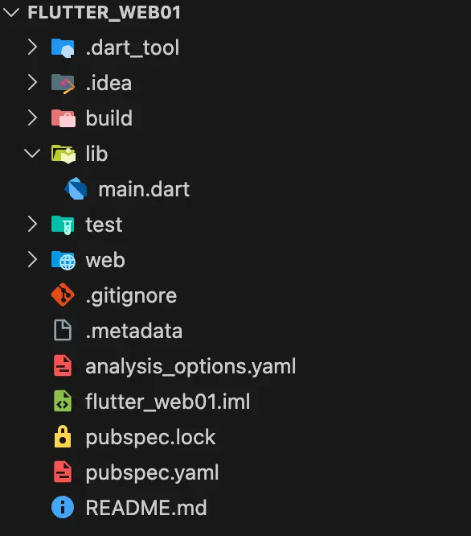

## 1.创建Flutter项目

配置Flutter环境后，我们就可以创建Flutter项目了，第一次先尝试最简单的web项目。

```sh
# 创建Flutter项目(web项目)
$ flutter create --platforms web flutter_web01

# 创建Flutter项目(web + iOS项目)
flutter create --platforms=ios,web my_app

# 创建Flutter项目(web + iOS项目)，--org 指定 iOS 的 Bundle Identifier 前缀
flutter create --platforms=ios,web --org com.yourcompany my_app

# 进入项目目录
$ cd my_app

# 运行Flutter项目
$ flutter run
```


其实对于一些命令和参数，可以通过`flutter help`来查看。

```sh
# 查看Flutter帮助
flutter help

# 查看子命令的帮助 flutter help <cmd> ，例如: flutter help create
flutter help create
```

## 2.Flutter项目结构

创建完项目之后，项目目录结构如下：

<p align="center">
  
</p>

具体每个文件的作用：
- `.dart_tool` Dart工具生成的文件和缓存
- `.idea` Intellij IDEA 项目配置文件
- `.vscode` Visual Studio Code 项目配置文件（如果有的话）
- `build` 项目构建的缓存目录，包含编译生成的文件
- `lib` Flutter 项目的 Dart 代码目录，包含应用的主要代码
- `test` Flutter 项目的测试代码目录
- `android` Android 平台特定配置和资源目录(如果有的话)
- `ios` iOS 平台特定配置和资源目录(如果有的话)
- `web` Web 平台特定配置和资源目录(如果有的话)
- `windows` Windows 平台特定配置和资源目录(如果有的话)
- `linux` Linux 平台特定配置和资源目录(如果有的话)
- `macos` macOS 平台特定配置和资源目录(如果有的话)
- `metadata` Flutter项目标识文件(自动生成)
- `analysis_options.yaml` Flutter项目分析配置文件，配置静态代码分析工具
- `flutter_core.iml` 用于存储模块(Module)的特定设置
- `pubspec.lock` Flutter 项目的依赖配置文件(锁定对比使用)
- `pubspec.yaml` Flutter 项目的依赖配置文件(库、插件、资源`Assets`等)
- `README.md` 项目的 README 文件


## 3.runApp()函数

项目的`main`函数是Flutter应用的入口点，它负责初始化应用并启动Flutter引擎。
```dart
void main() {
  runApp(const MyApp());
}
```


**1.为什么`runApp()`函数的参数写成`const MyApp()`而不是`MyApp()`？**
`Widget` 是描述 UI 的不可变配置类（`immutable`），可以被广泛缓存和复用。因此 `Flutter SDK` 内几乎所有 `widget` 都是：

- 字段声明为 `final`
- 构造函数为 `const`


在 Dart 中，`const` 表示：
- 在 编译期 `evaluated`（非运行时）
- 在 常量池 中 `canonicalized`（相同常量对象共用同一个实例）
- 对象必须完全不可变

所以 Dart 编译器需要保证：

| 条件 | 必须满足 |
| ---- | ---- |
| 所有字段是 `final` | ✔ 保证对象不可变 |
| 常量池 `canonicalized` | ✔ 相同常量对象共用同一个实例 |
| 构造函数是 `const` | ✔ 表示构造逻辑可被编译期求值 |
| 所有参数必须是 `compile-time constant` | ✔ 内容能在编译期确定 |


**2.自己写的类，构造函数是`const`，并且类的所有字段都可作为编译期常量，那么实例即可被声明为`const`。**

```dart
class Person {
  // Dart 中 const 对象要求类的所有字段必须是 final 的
  final String name;
  final int age;

  // 只要一个类的 构造函数是 const，并且类的所有字段都可作为编译期常量，那么实例即可被声明为 const。
  // 构造函数不是 const → 不能 const，所以需要加上 const 关键字
  const Person(this.name, this.age);
}

// 此时才可以声明为 test(const Person('HouWan', 25))
```

**3.在`Flutter`中，万物皆为`Widget`。**


## 4.MaterialApp

`MaterialApp` 是 `Flutter` 中最常用的 `Widget`，它是一个 `Material Design` 风格的应用程序框架。

```dart
runApp(
  MaterialApp(
    title: '我是标题，哈哈哈',
    theme: ThemeData(scaffoldBackgroundColor: Colors.deepPurple),
    home: Scaffold(),
  ),
);
```

- `title` 应用的标题，会显示在设备的任务栏或应用抽屉中(可以不设置)。
- `theme` 应用的主题，定义了应用的颜色、字体、图标等样式。
- `home` 应用的首页，通常是一个 `Widget` 树的根节点。

## 5.Scaffold组件
`Scaffold` 是 `Flutter` 中最常用的 `Widget`，它是一个 `Material Design` 风格的应用程序框架。

`Scaffold` 组件提供了一个标准的应用程序布局，包含了应用的顶部栏、主体内容和底部导航栏等。

```dart
Scaffold(
  appBar: AppBar(
    title: const Text('Flutter Demo Home Page'),
  ),
  body: const Center(
    child: Text('Hello, World!'),
  ),
);
```

- `appBar` 应用的顶部栏，通常是一个 `AppBar` 组件，显示标题、导航按钮、操作按钮等。
- `body` 应用的主体内容，通常是一个 `Widget` 树的根节点，是页面的核心。
- `bottomNavigationBar` 应用的底部导航栏，通常是一个 `BottomNavigationBar` 组件。
- `backgroundColor` 整个`Scaffold`的背景颜色，通常是一个 `Color` 类型的参数。
- `floatingActionButton` 应用的悬浮操作按钮，通常是一个 `FloatingActionButton` 组件。


## 6.项目总结

代码如下：
```dart
import 'package:flutter/material.dart';

void main() {
  runApp(
    MaterialApp(
      title: 'App 名称',
      theme: ThemeData(scaffoldBackgroundColor: Colors.deepPurple),
      home: Scaffold(
        appBar: AppBar(title: const Text('我是导航栏')),
        body: MyHomePage(),
        backgroundColor: Colors.blueGrey,
        bottomNavigationBar: Container(
          height: 68,
          color: Colors.white,
          child: Center(child: Text('底部区域')),
        ),
      ),
    ),
  );
}

class MyHomePage extends StatelessWidget {
  const MyHomePage({super.key});

  @override
  Widget build(BuildContext context) {
    return Center(
      child: Text(
        '我是页面的内容',
        style: TextStyle(color: Colors.white, fontSize: 24),
      ),
    );
  }
}
```


- `Container` 容器组件，用于包裹其他 `Widget`，可以设置背景颜色、边框、内边距、高度等。
- `Text` 文本组件，用于显示文本内容。
- `Scaffold` 组件，用于提供标准的应用程序布局，包含顶部栏、主体内容和底部导航栏等。
- `MaterialApp` 组件，用于提供 `Material Design `风格的应用程序框架。

### 6.1 关于 MyHomePage 构造方法

拆解 `const MyHomePage({super.key})`，这一行实际上是三件事拼在一起。

**第一件事**：`{...}` 是 Dart 的命名参数语法，Dart 的函数参数有两种风格：
```dart
// 位置参数（普通参数，Swift 那种）
void foo(int a, String b) {}
foo(1, "hi");

// 命名参数（用大括号包起来，调用时要写名字，默认可选）
void bar({int? a, String? b}) {}
bar();                  // 可以全不传
bar(a: 1);              // 可以只传一个
bar(a: 1, b: "hi");     // 顺序无所谓

// 类比 Swift：
func bar(a: Int? = nil, b: String? = nil) {}
bar()              // 一样可以全不传
bar(a: 1)
```

所以 `MyHomePage({super.key})` 的意思是："这个构造器接受一个叫 `key` 的命名参数，可传可不传"。

**第二件事**：`super.key `是"参数转发"语法糖（Dart 2.17+）
完整版的写法长这样：
```dart
// 意思是："我这个构造器接受一个 Key? 类型的 key 参数，然后原封不动地传给父类的构造器"。
const MyHomePage({Key? key}) : super(key: key);


// 类比 Swift（Swift 没有这个语法糖，但意思像），概念上类似这样：
init(key: Key? = nil) {
    super.init(key: key)  // 转发给父类
}
```

> 因为这种"接收一个参数，立刻转发给 super"的写法在 Flutter 代码里到处都是（每个 `widget` 都写一遍），Dart 团队就加了个简写 `Widget({super.key})` 语法糖

**第三件事**：`const` 关键字——这才是真正重要的

`const MyHomePage(...)` 表示这个构造器可以在编译期就创建对象。

为什么重要？因为 Flutter 会频繁地重建 `widget` 树（每次 `setState()` 都重建）。如果一个 `widget` 是 `const` 创建的：

- 同样的参数下，对象只创建一次，后续直接复用
- Flutter 在比较新旧 `widget` 树时，发现是同一个 `const` 对象，可以直接跳过这个分支的重建
- 性能优化效果非常明显，尤其是嵌套很深的页面

> 这就是为什么你看代码里到处都是 `const Text(...)`、`const SizedBox(...)`、`const Center(...)`——能用 `const` 就用 `const`。Dart 的 `const` 是语言级支持的编译期常量构造.


**那 `key` 这个东西本身是干嘛的？**

简单理解：给 `widget` 一个"身份证"，让 Flutter 在比较新旧两棵 `widget` 树时认得出"哪个是哪个"。
举个例子：你有一个列表显示 3 个 item，用户删掉了第 2 个。Flutter 在重建时要知道："剩下的两个，是原来的第 1 个和第 3 个，不是新建的两个"——这时候 `key` 就有用了。

对你现阶段：
- 99% 的情况下你不需要主动传 `key`
- 但每个自定义 `widget` 都"暴露"一个 `key` 参数，是为了给未来留口子——万一以后用到了，使用方可以传
- 这就是 Flutter 团队推荐每个 `widget` 都写 `{super.key}` 的原因


## 7.MaterialApp和Scaffold的关系

在`main()`方法中，`runApp()`方法的参数是一个`Widget`，通常是一个`MaterialApp`组件。如果我们直接传递一个`Scaffold`组件，会报错，因为：

报错的核心是 `Scaffold` 无法找到所需的 `Directionality`（文本方向）组件。这不是一个Bug，而是Flutter框架**依赖注入**机制的体现。

- **根本原因**：`Scaffold` 等许多`Material Design`组件依赖于一组由顶层`Widget`提供的环境数据（Inherited Widget），例如：
  - `Directionality`：决定文本是从左到右（LTR）还是从右到左（RTL）显示。
  - `MediaQuery`：提供设备屏幕尺寸、方向等信息。
  - `Localizations`：提供国际化/本地化支持。
  - `Theme`：提供颜色、字体等主题数据。

- **解决方案**：`MaterialApp`（或 `WidgetsApp`、`CupertinoApp`）的核心作用之一，就是在应用根部自动创建并提供这些必需的运行环境。当你把 `Scaffold` 直接作为根组件时，它无法向上找到这些环境数据，因此抛出异常。

所以，`MaterialApp` 和 `Scaffold` 更像是“物业服务”和“毛坯房框架”的关系：

- MaterialApp 是“物业服务” (应用级容器)
  - 它是整个`Material Design`风格应用的顶层配置和容器。它不直接绘制具体的UI，而是为它之下的所有子Widget提供一整套基础服务，包括：导航路由、主题、国际化、以及上面提到的文本方向等环境数据。它决定了整个App的“基础装修标准”和“公共设施”

- `Scaffold` 是“毛坯房框架” (页面级容器)
  - 它是一个具体的页面布局框架，用于快速搭建符合Material Design规范的单个页面。它提供了标准的“房间结构”，如导航栏 (`appBar`)、主内容区 (`body`)、底部导航栏 (`bottomNavigationBar`)、悬浮按钮 (`floatingActionButton`)、抽屉菜单 (`drawer`) 等。你的主要UI内容就放在它的 body 里。

**一句话总结**：`MaterialApp` 为整个App提供生存环境和服务，而 `Scaffold` 在这个环境下搭建一个具体的标准页面。一个 `MaterialApp` 里可以包含多个不同的 `Scaffold` 页面（通过路由导航切换）。

|  | `MaterialApp` | `Scaffold` |
| --- | --- | --- |
| 定位 | 应用级根组件，提供全局环境 | 页面级骨架组件，搭建具体页面结构 |
| 职责 | 配置路由、主题、国际化、文本方向等。 | 提供 `AppBar`、`Body`、`Drawer`、`BottomNavigationBar` 等标准`Material`布局槽位 |
| 数量 | 通常一个应用只有一个 | 一个应用可以有多个（不同页面） |
| 关系 | 是 `Scaffold` 的祖先，为其提供运行所必需的上下文环境 | 是 `MaterialApp` 的后代，提供具体的页面布局和功能 |


