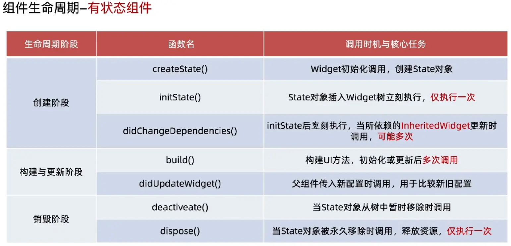

## 1.组件 Widget

在Flutter中，万物皆组件（`Widget`）。理解如下：

### 1.1 核心概念：蓝图 vs 实体

这是理解`Widget`最重要的思维转换：
- **iOS** (`UIView`)： 一个`UIView`是一个可变的、长生命周期的对象。你创建它，持有它的引用，在应用运行期间反复修改它的属性（`frame`, `backgroundColor`等），它会保持状态并直接渲染到屏幕。
- **iOS** 是命令式的， “如何做 (How)”
- **Flutter** (`Widget`)： 一个`Widget`是一个轻量的、不可变的配置描述。它只声明在特定时刻，视图应该是什么样子（比如“一个红色的、居中的文本”）。`Widget`本身不负责绘制，也不管理状态（`StatefulWidget`通过分离的`State`对象管理）。它更像是一张交给框架的“施工图纸”。
- **Flutter** 是声明式的，“是什么 (What)”； 核心是： `UI = f(State)`


### 1.2 渲染原理：三棵树 (Widget, Element, RenderObject)

这是Flutter底层高效工作的核心机制，理解了它，很多行为就变得清晰：

| 树 | 类比 | 说明 | 生命周期 |
| --- | --- | --- | --- |
| `Widget`树 | 蓝图/图纸 | 描述UI的配置（结构、样式、数据）。轻量，频繁重建 | 短暂，每次build都可能产生新实例 |
| `Element`树 | 施工队/粘合剂 |  `Widget`的实例，包含了运行时的状态和逻辑，负责管理生命周期，连接`Widget`和`RenderObject`。是稳定的树结构 | 较长，仅在`Widget`配置改变时才调整 |
| `RenderObject`树 | 真正的建筑与画家 | 负责布局（计算大小位置）和绘制（渲染到屏幕），是 `Widget` 渲染到屏幕的“物理实体” | 最长，只在必要时（如尺寸变化）才触发昂贵的布局和绘制 |


**工作流程**：当你调用`setState`时，`Widget`树重建。Flutter使用`Element`树来**智能地对比**新旧`Widget`树（**Diff算法**），只对发生变化的部分，更新对应的`Element`和`RenderObject`，从而最小化昂贵的布局和绘制操作。

### 1.3 Widget的类型与组合哲学

`Widget`按功能分类：
- **布局**：如 `Row`, `Column`, `Stack`, `ListView`等
- **样式与装饰**：如 `Container`, `Padding`, `DecoratedBox`等
- **基础**：如 `Text`, `Image`, `Icon`等
- **功能性**：提供导航 (`Navigator`)、主题 (`Theme`)、手势 (`GestureDetector`)等


**组合模式**：这是Flutter UI构建的灵魂。在iOS中，你常通过继承`UIView`来定制复杂视图。在Flutter中，你几乎总是通过组合多个简单的小`Widget`来创建一个复杂的大`Widget`。

### 1.4 和iOS的对比

这里有一份iOS与Flutter核心概念的快速对照表：

| 概念/任务 | iOS (UIKit/SwiftUI) | Flutter (Dart) | 关键差异提示 |
| :--- | :--- | :--- | :--- |
| **基础视图单元** | `UIView` / `View` 对象 | `Widget` 配置描述 | **思维范式转换的核心** |
| **构建UI方式** | 命令式修改 / SwiftUI声明式 | 声明式组合 | Flutter全声明式，更统一 |
| **布局系统** | Auto Layout / Frame | 基于约束的盒子模型（`Row`,`Column`,`Flex`） | Flutter布局逻辑写在Widget树中 |
| **状态管理** | 直接修改属性 / `@State` | `StatefulWidget` + `setState()` 或状态管理库 | Flutter状态与UI分离更明确 |
| **生命周期** | `viewDidLoad`, `viewDidAppear` | `initState`, `build`, `dispose` | 与Widget/Element树绑定 |
| **样式与主题** | 直接设置属性 / `ViewModifier` | `Theme` Widget + 样式参数 | 通过上下文 (`Theme.of`) 获取主题 |

### 1.5 分类

Flutter分为两大类：
- **无状态组件**：`StatelessWidget`，只依赖于外部参数构建UI，不管理内部状态。
- **有状态组件**：`StatefulWidget`，通过`State`对象管理内部状态，状态变化时可以触发UI更新。

|  | `StatelessWidget`无状态 | `StatefulWidget`有状态 |
| :--- | :--- | :--- |
| 特征 | 一旦创建，内部状态不可变 | 持有可在其生命周期内变化的状态`State`对象 |
| 使用场景 | 静态内容展示，如文本、图标等 | 交互式组件，如开关、输入框等 |
| 声明周期 | 简单、主要是`build`方法 | 复杂，包含`initState`, `build`, `dispose`等方法 |
| 代码结构 | 单个类 | 两个类：`Widget`和`State` |


## 2.无状态组件 StatelessWidget

### 2.1 StatelessWidget

无状态组件 `StatelessWidget`
- 定义：创建一个新的类，继承`StatelessWidget`，并实现`build`方法。
- 要点：
  - 无状态组件只依赖于外部参数，不管理内部状态。
  - 无状态组件的`build`方法只被调用一次，或者在依赖的参数变化时调用。
  - 无状态组件的`build`方法返回一个`Widget`树，描述了组件的UI。

代码示例:
```dart
class MyHomePage extends StatelessWidget {
  const MyHomePage({super.key});  // StatelessWidget 推荐覆写 const 构造函数

  @override
  Widget build(BuildContext context) {
    return Center(
      child: Text(
        '我是页面的内容',
        style: TextStyle(color: Colors.white, fontSize: 24),
      ),
    );
  }
}
```

### 2.2 生命周期

无状态组件 `StatelessWidget` 的生命周期方法只有一个：`build`。

- 调用时机：
  - 组件创建时，首次调用`build`方法。
  - 依赖的参数变化时，调用`build`方法。
  - 父组件状态变化时，也可能会调用`build`方法。

- 主要用途：构建组件的UI。

- 注意事项：
  - 无状态组件的`build`方法不能执行耗时操作，也不能有副作用。
  - 无状态组件的`build`方法返回的`Widget`树不能包含状态ful组件。


## 3.有状态组件 StatefulWidget

### 3.1 StatefulWidget

有状态组件 `StatefulWidget`
- 定义：创建一个新的类，继承`StatefulWidget`，并实现`createState`方法；第二个类继承`State<第一个类名>`，负责管理所有可变的数据和业务，并实现`build`方法。

- 要点：
  - 有状态组件持有一个`State`对象，用于管理内部状态。
  - `State`对象在组件的生命周期内保持不变，不会被重新创建。
  - 有状态组件的`build`方法依赖于`State`对象的状态，**状态变化时会触发UI更新**。
  - `State`类中调用`setState`方法，会触发`build`方法的调用，重新构建UI。

代码示例：
```dart
/// 有状态Widget
class MainPage extends StatefulWidget {
  const MainPage({super.key});

  @override
  State<StatefulWidget> createState() => _MainPageState();
}

/// 一般会将 State 类名 与 StatefulWidget 类名 保持一致，并在类名前添加下划线 _
class _MainPageState extends State<MainPage> {
  int _currentIndex = 0;  /// 状态变量，记录当前的数字

  @override
  Widget build(BuildContext context) {
    debugPrint("State 生命周期方法： build");
    return Center(
      child: Column(
        mainAxisAlignment: MainAxisAlignment.center,
        spacing: 20,
        children: [
          Text(
            '当前的数字是 $_currentIndex',
            style: TextStyle(color: Colors.white, fontSize: 24),
          ),
          // 一个 按钮
          IconButton(
            icon: Icon(Icons.add, color: Colors.white),
            onPressed: _onItemTapped,
          ),
        ],
      ),
    );
  }

  void _onItemTapped() {   /// 点击按钮时调用，增加当前数字
    setState(() {
      _currentIndex += 1;
    });
  }

  @override
  void initState() {
    super.initState();
    debugPrint("State 生命周期方法： initState");
  }

  @override
  void dispose() {
    super.dispose();
    debugPrint("State 生命周期方法： dispose");
  }
}
```

### 3.2 生命周期

对于 `State` 类，它的生命周期方法如下:

| 生命周期方法 | 何时调用（时机） | 主要用途 | 常见使用场景 | 注意事项 | 对应源码调用位置 |
|--------------|------------------|----------|--------------|-----------|-------------------|
| **`initState()`** | State 被插入 Element Tree 时（**仅一次**） | 初始化状态、控制器、订阅 | 创建 `AnimationController`、`StreamSubscription` | 不能依赖 context 的 inherited widget | `StatefulElement.mount()` |
| **`didChangeDependencies()`** | `initState()`之后立即调用；依赖的 InheritedWidget 变化 | 获取依赖于 InheritedWidget 的数据 | `Theme.of`、`MediaQuery.of`、`Provider.of` | 可能多次调用，不适合重逻辑 | State.dependOnInheritedWidgetOfExactType |
| **`build()`** | 每次`setState()`、父 widget rebuild、依赖更新 调用 | 构建 UI | 返回 widget 树 | 绝不能执行耗时操作；无副作用 | `Element.performRebuild()` |
| **`didUpdateWidget(oldWidget)`** | 父 widget rebuild，且参数变化时 | 在父组件参数变化时同步内部 state | oldWidget.value != widget.value 情况 | 不用于初始化，只用于参数响应 | `StatefulElement.update()` |
| **`setState(fn)`** | 主动触发 UI 重建 | 通知 Element 调用 build | 点击按钮、数据更新 | 不能 async；不能在 dispose 调用 | `State.setState()`（标记 dirty） |
| **`deactivate()`** | 当 State 临时从树上移除时 | 可保存跨树移动前的状态 | Tab 切换、Offstage、Navigator 中缓存页面 | 页面可能会重新插入 → 不要释放资源 | `Element.deactivate()` |
| **`dispose()`** | State 永久从树移除时（仅一次） | 释放资源 | controller.dispose()、unsubscribe | 不能`setState()`；不能使用 context | `StatefulElement.unmount()` |



> `InheritedWidget`是专门用于在 Widget 树中传递数据的组件（自顶向下高效地共享数据）。它的主要作用是将数据从父 widget 传递到子 widget，而不需要在每个子 widget 中都传递。

流程图如下（点击放大查看）:

<!-- 注意下面图片的文件路径问题，跟直接  这样不同 -->
<p align="center">
  
</p>

### 3.3 setState()

对于 `setState()` 方法，下面的2种写法：
```dart
// 写法1：
void _onItemTapped() {
  setState(() {
    _currentIndex += 1;
  });
}

// 写法2：
void _onItemTapped() {
  _currentIndex += 1;
  setState(() { });
}
```

在绝大多数情况下，两种写法在效果上没有区别。但从代码意图、框架设计原理和工程最佳实践上，**写法1是唯一正确的选择**。

简化自 State.setState 源码:
```dart
void setState(VoidCallback fn) {
  // 1. 执行传入的回调函数 `fn` (即你写的 `() { _currentIndex += 1; }`)
  final Object? result = fn() as dynamic;
  // 2. 标记与该State关联的Element为“脏”(dirty)
  _element!.markNeedsBuild();
  // 3. 调度新一帧，在下一帧中重建Widget
}
```

关键在于 `markNeedsBuild()`。它不会立刻重建，而是将重建任务放入队列，等待下一次 `VSync` 信号进行统一处理，这是性能优化（避免单帧内多次无效重建）的关键。


> 注意⚠️：`setState()` **必须立即同步完成**，不能做异步操作。也要避免在 `dispose()` 方法中调用 `setState()`。避免在`setState()`中做复杂的逻辑操作，只做简单的状态更新。


## 4.理解StatefulWidget

`StatefulWidget` 类通常只有一个 `createState()` 方法，这涉及到Flutter架构的 `Widget` 树与 `Element` 树。

> 结论：`StatefulWidget` 是“配置手册”，而 `State` 才是“真正的打工人”。


### 4.1 StatefulWidget 中应该写什么？

既然 `StatefulWidget` 在每次刷新时都可能被销毁并重新创建（它的生命周期极短，类似于一个不可变的配置结构体 `Struct`），那么它里面只能写“只读的、外部传入的初始化配置参数”。

具体来说，有以下三大核心场景：

**场景 A：接收外部（父组件）传入的数据和回调（类似 iOS 的 init 传参）**

所有需要从外面传进来的属性，必须定义在 `StatefulWidget` 中。而且因为 `Widget` 是不可变的，这些属性必须全部用 `final` 修饰。

**场景 B：接收外部传进来的“构造器/逻辑控制权”**

比如外部想控制这个组件的滚动、输入或动画，会传进来一个 `ScrollController`、`TextEditingController` 或 `AnimationController。`

**场景 C：定义组件的默认常量配置**
比如定义一个按钮的默认高度、默认颜色等。

```dart
// 📱 正确示范：StatefulWidget 只做配置接收器
class CustomUserCard extends StatefulWidget {
  // 1. 接收外部传入的只读数据
  final String userId;
  final String userName;
  
  // 2. 接收外部传入的行为回调（闭包）
  final VoidCallback onFollowPressed;

  // 3. 接收外部传进来的控制器
  final ScrollController? parentScrollController;

  // 4. 构造函数：所有参数在这里组装
  const CustomUserCard({
    super.key,
    required this.userId,
    required this.userName,
    required this.onFollowPressed,
    this.parentScrollController,
  }); // 完美加 const，说明它本身是编译时静态的

  @override
  State<CustomUserCard> createState() => _CustomUserCardState();
}
```

### 4.2 为什么非要这么拆？（底层双树架构解密）

“为什么不把所有东西揉进一个类里，非要折腾出 `Widget` 和 `State` 两个类？”

这是因为 Flutter 底层有一套极其高效的虚拟 DOM 机制（三树一体）：
- `StatefulWidget` 属于 `Widget` 树：它的创建和销毁代价极其廉价。每次网络请求回来、或者父级 `setState` 刷新，这个 `CustomUserCard` 实例就会直接被垃圾回收（GC）掉，然后重新 New 一个新的。
- `State` 属于 `Element` 树/状态树：它的生命周期非常长！只要这个组件还在屏幕上显示，对应的 `State` 实例就永远不会被销毁。它就像一块长寿的内存磐石，默默记录着用户的输入、网络请求到的数据、开关的状态。

> 如果把逻辑和变量写在 `StatefulWidget` 里，每次父级一刷新，变量就会被全部重置（因为 `Widget` 被重新 `New` 了）。这就是为什么所有会变的状态（`State`）、生命周期方法（`initState`/`dispose`）以及组件的拼装逻辑（`build`），必须写在 `State` 类里。

### 4.3 State 内部如何访问 StatefulWidget 里的变量？

既然数据在 `StatefulWidget` 里，而 `build` 方法在 `State` 里，那 `State` 怎么拿到那些 `final` 属性呢？

Flutter 官方提供了一个内置的指针：`widget`。

> 在 `State` 类的内部任何地方，你都可以直接通过 `widget.xxx` 来访问宿主 `StatefulWidget` 里的任何参数。

💻 工业级全分工 Demo 演示：
```dart
// ==========================================
// 1. 配置层：负责接单、拿参数（生命周期极短，随时被重新创建）
// ==========================================
class FollowButton extends StatefulWidget {
  final String userId; // 外部传进来的用户ID
  final bool initialIsFollowed; // 外部传进来的初始关注状态

  const FollowButton({
    super.key,
    required this.userId,
    required this.initialIsFollowed,
  });

  @override
  State<FollowButton> createState() => _FollowButtonState();
}

// ==========================================
// 2. 状态与逻辑层：负责干活、存数据（生命周期长，常驻内存）
// ==========================================
class _FollowButtonState extends State<FollowButton> {
  // 内部维护的真正会变的状态
  late bool _isFollowed;
  bool _isLoading = false;

  @override
  void initState() {
    super.initState();
    // 💡 技巧：通过 `widget.` 拿到 StatefulWidget 传进来的初始值，赋值给内部变量
    _isFollowed = widget.initialIsFollowed;
  }

  // 真正的业务逻辑写在 State 中
  void _toggleFollow() async {
    setState(() => _isLoading = true);

    // 💡 技巧：通过 `widget.userId` 拿到配置层里的用户 ID 去发网络请求
    bool success = await ApiService.changeFollowStatus(widget.userId, !_isFollowed);

    if (success) {
      setState(() {
        _isFollowed = !_isFollowed;
        _isLoading = false;
      });
    }
  }

  @override
  Widget build(BuildContext context) {
    // 所有的组件拼装和渲染逻辑，老老实实呆在 State 中
    return OutlinedButton(
      onPressed: _isLoading ? null : _toggleFollow,
      child: Text(_isLoading ? '提交中...' : (_isFollowed ? '已关注' : '加关注')),
    );
  }
}
```


