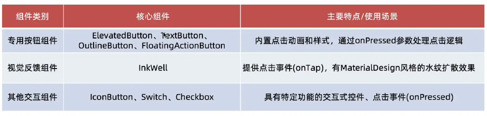

## 1.GestureDetector

事件`GestureDetector`是 Flutter 中用于处理点击事件的组件。它可以包裹任何其他组件，当用户点击包裹的组件时，会触发回调函数。

### 1.1 基本用法

```dart
GestureDetector(
  onTap: () {
    // 处理点击事件
  },
  child: Container(
    // 子组件
  ),
)
```

### 1.2 常用属性

- `onTap`：点击事件回调函数。
- `onDoubleTap`：双击事件回调函数。
- `onLongPress`：长按事件回调函数。
- `onHorizontalDragUpdate`：水平拖动事件回调函数。
- `onVerticalDragUpdate`：垂直拖动事件回调函数。

### 1.3 示例

```dart
GestureDetector(
  onTap: () {
    debugPrint("点击了组件");
  },
  child: Container(
    width: 200,
    height: 200,
    color: Colors.blue,
  ),
)
```

## 2.Widget自带事件

一些 `Widget` 自带的事件，例如 `TextButton`、`IconButton`就自带 `onPressed` 事件。




