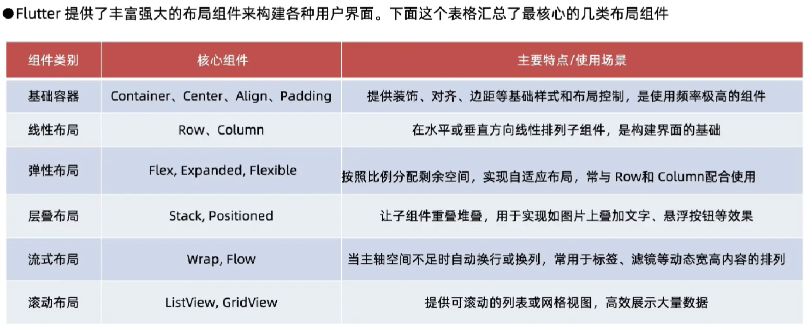

## 1.分类认识

### 1.1 基础结构类 Widgets（结构性 / 布局的根基）

| Widget | 核心特点 | 使用场景 | 注意事项 | 类比（iOS / Android） |
|--------|----------|----------|----------|------------------------|
| Container | 集合 padding/decoration/alignment 的简化控件 | 包装一个子控件、简单布局 | 不建议过度嵌套；无 child 时不渲染 | UIView + AutoLayout |
| SizedBox | 限制宽高 | 固定尺寸，占位符 | 经常用于 spacing | UIView(frame) |
| Padding | 包裹并添加内边距 | 常用于布局微调 | 仅对 child 生效 | layoutMargins |
| Align / Center | 控制 child 的对齐方式 | 子控件位置调整 | 会产生 RenderPositionedBox | UIView ContentMode |
| Expanded / Flexible | 在 Row/Column 中分配空间 | 弹性布局 | 仅在 Flex 系列中可用 | UIStackView distribution |
| FittedBox | 缩放 child 适应父容器 | 图标、文字缩放 | 可能引起额外布局开销 | UIView contentMode.scaleAspectFit |

### 1.2 基础结构类 Widgets（结构性 / 布局的根基）

| Widget | 核心特点 | 使用场景 | 注意事项 |
|--------|----------|----------|----------|
| Row / Column | 水平 / 垂直布局 | 页面主体结构 | 可能产生深层树结构；性能好 |
| Stack | 子控件重叠布局 | 浮层、Badge、悬浮按钮 | 类似 iOS frame 布局 |
| Wrap | 自动换行布局 | 标签、Chip | 比 Row/Column 更灵活但更耗性能 |
| GridView | 网格布局 | 图片墙、商品列表 | 控制 item 数量防爆内存 |
| ListView | 垂直列表（懒加载） | 聊天、Feed | builder 模式性能最佳 |
| CustomScrollView + Slivers | 高度定制的可滚动区域 | 复杂页面（淘宝首页） | 学习成本高但强大 |

### 1.3 可视控件 Widgets（显示内容）

| Widget | 核心特点 | 使用场景 | 注意事项 | 类比 |
|--------|----------|----------|----------|--------|
| Text | 显示文本（富文本基础） | 标题、正文 | textScaleFactor 会被系统字体放大 | UILabel |
| RichText | 富文本（内部分片） | 渲染复杂格式 | 不支持 selection（需 SelectableText） | NSAttributedString |
| Icon / IconButton | 显示图标 | 按钮、装饰 | Web 平台部分图标不支持 | UIImageView / UIButton |
| Image | 支持 asset/network/memory | 图像展示 | 建议使用缓存（cached_network_image） | UIImageView |
| Placeholder | 占位图 | 开发调试 | 会自动绘制一个斜线框 | UIView placeholder |

### 1.4 交互类 Widgets（按钮、手势、交互行为）

| Widget | 特点 | 使用场景 | 注意事项 | 类比 |
|--------|------|----------|----------|--------|
| GestureDetector | 纯手势识别，零 UI | 点击、拖拽、缩放等手势 | hitTest 行为对性能有影响 | UIGestureRecognizer |
| InkWell | Material 风格触控波纹 | 按钮、卡片点击 | 需有 Material ancestor 才有波纹 | Android ripple |
| TextButton / ElevatedButton / OutlinedButton | Material 标准按钮 | 操作按钮 | 样式由 ButtonStyle 控制 | UIButton |
| Switch / Checkbox / Radio | Material 表单组件 | 表单输入 | 勿在父 widget rebuild 时重建 | UISwitch |

### 1.5 状态展示 / 反馈 Widgets

| Widget | 特点 | 场景 | 注意事项 |
|--------|------|------|----------|
| CircularProgressIndicator | 加载中 | 异步任务等待 | 避免页面全局无限刷新 |
| LinearProgressIndicator | 进度条 | 下载、上传 | value 为 null → 不确定进度 |
| AlertDialog / Dialog | 弹窗 | 提示框、对话框 | 必须在 Navigator 上下文中 |
| SnackBar | 底部提示 | 短消息提示 | ScaffoldMessenger 调用 |

### 1.6 页面 / 导航 Widgets

| Widget | 特点 | 场景 | 注意事项 | 类比 |
|--------|------|------|----------|--------|
| Scaffold | 页面基础结构（AppBar、Body、FAB） | 每个页面的基本骨架 | 一层页面一个 Scaffold | UIViewController base |
| AppBar | 标准导航栏 | 顶栏标题、菜单 | 使用 PreferredSize 指定高度 | UINavigationBar |
| BottomNavigationBar | 底部导航 | 多 Tab 切换 | 适合搭配 IndexedStack | UITabBar |
| Drawer | 左侧抽屉 | 菜单 | 滑动手势容易与页面冲突 | Android DrawerLayout |

### 1.7 表单 / 输入类 Widgets

| Widget | 特点 | 场景 | 注意事项 | 类比 |
|--------|------|------|----------|--------|
| TextField | 输入框（最常用） | 表单输入 | controller 必须 dispose | UITextField |
| TextFormField | 输入框 + 表单验证 | 登录等表单 | 搭配 Form 使用 | UITextField + Validator |
| Form | 表单容器 | 集中管理表单状态 | GlobalKey 管理 | UIView Form |
| DropdownButton | 下拉选择 | 配置项选择 | 对移动端友好度一般 | UIPickerView |

### 1.8 高级渲染 Widgets

| Widget | 特点 | 场景 | 注意事项 | 类比 |
|--------|------|------|----------|--------|
| CustomPaint | 自定义绘制（Canvas） | 绘制图表、波浪等 | 尽量使用 shouldRepaint 控制重绘 | CoreGraphics drawRect |
| RepaintBoundary | 隔离重绘区域 | 性能优化 | 过度使用反而降低性能 | UIView layer 内容隔离 |
| ClipRRect / ClipPath | 裁剪 | 圆角、形状裁剪 | 裁剪会触发额外开销 | CALayer mask |

### 1.9 动画 Widgets

| Widget | 特点 | 场景 | 注意事项 | 类比 |
|--------|------|------|----------|--------|
| AnimatedContainer | 自动执行过渡动画 | 简单动画 | 配置变化触发动画 | UIView.animate |
| Hero | 页面切换间共享元素动画 | 大图预览 | tag 必须唯一 | UIKit Hero-like |
| AnimatedOpacity / AnimatedScale | 转场动画 | 淡入淡出、缩放 | 性能好 | UIView property animator |
| FadeTransition / SlideTransition | 使用 AnimationController | 复杂动画流程 | 需手动 dispose | CoreAnimation Keyframe |

### 1.10 性能 / 框架级 Widgets

| Widget | 特点 | 场景 | 注意事项 |
|--------|------|------|----------|
| ValueListenableBuilder | 轻量状态刷新 | 替代 setState 场景 | 仅 widget 层使用 |
| LayoutBuilder | 根据父尺寸构建不同布局 | 响应式页面 | 会多次 rebuild |
| MediaQuery | 读取屏幕信息 | 响应式布局 | 依赖变化会触发 build |
| Builder | 提供新的 context | 分隔上下文作用域 | 常用于 Scaffold 小技巧 |

## 2.大纲总结

| 类别 | Widget (示例) | **核心特点 / 设计哲学** | **典型使用场景** | **注意事项 / 原理级坑点** |
| :--- | :--- | :--- | :--- | :--- |
| **基础 & 显示** | `Text` | 显示单一样式文本。其渲染对象`RenderParagraph`处理文本布局、换行、样式。 | 任何需要显示文字的地方。 | 复杂样式或混合样式需使用`Text.rich`或`RichText`。**性能**：频繁变化的文本考虑缓存`TextSpan`。 |
| | `Image` | 图片资源展示。支持多种来源(`AssetImage`, `NetworkImage`)。图像解码在IO线程，渲染在GPU。 | 显示图标、照片、网络图片。 | **内存**：大图需使用`cacheWidth`/`cacheHeight`或`ResizeImage`优化。网络图片推荐使用`cached_network_image`包。 |
| | `Icon` | 显示字体图标(如Material Icons)。实质是特殊字体的文本渲染，矢量、单色、轻量。 | 工具栏、按钮、状态指示等。 | 可定制颜色、大小。使用自定义图标字体需在`pubspec.yaml`中声明。 | 
| **布局 & 约束** | `Container` | **组合容器**。本身**不强制约束**，而是根据`child`和自身参数(`width`, `margin`等)综合决定尺寸。 | 需要组合padding、margin、装饰、对齐的简单场景。 | **理解其布局顺序**：先应用`constraints`，再根据`child`调整，最后应用`transform`。**过度使用会导致Widget树过深**。 |
| | `Row`, `Column` | **弹性(Flex)布局**。主轴方向排列子项，交叉轴方向对齐。其渲染对象`RenderFlex`实现。 | 水平或线性排列一组子控件。 | 子项默认最大尺寸。**关键**：使用`Expanded`/`Flexible`让子项共享剩余空间。非滚动布局，子项过多会溢出。 | 
| | `Stack` | **层叠布局**。子项可堆叠并可定位(`Positioned`)。`RenderStack`通过`StackParentData`存储子项偏移。 | 重叠视图（如按钮在图片上）、自定义绘制层。 | 默认所有子项左上角对齐。**定位基准**：`Positioned`的`top`/`left`等是相对于`Stack`的**四条边**，非父容器。 |
| | `Expanded`, `Flexible` | **弹性空间分配器**。必须作为`Row`/`Column`/`Flex`的直接子项。它们修改父`RenderFlex`的布局算法。 | 在弹性布局中，按比例或灵活地分配空间。 | `Expanded`强制填满剩余空间，`Flexible`可设置`fit`策略。**误用**：放在非Flex父容器中会引发布局错误。 | 
| **滚动 & 列表** | `ListView` | **滚动线性列表**。懒加载，视口外Widget会被回收，`RenderSliverList`管理滑动逻辑。 | 长列表、可滚动内容。 | **性能核心**：对于长列表，**必须**使用`ListView.builder`按需构建项。避免直接使用`children`传入大量Widget。 |
| | `GridView` | **滚动网格列表**。同样是懒加载，`RenderSliverGrid`管理网格布局。 | 照片墙、卡片网格、瀑布流。 | 同样推荐`.builder`构造函数。`SliverGridDelegate`控制布局（固定数量`GridDelegate.count`或固定尺寸`GridDelegate.extent`）。 |
| | `SingleChildScrollView` | **单子项滚动视图**。其`RenderPointerListener`处理手势，`RenderViewport`创建滚动视口。 | 内容超出屏幕但结构简单的场景（如表单）。 | **性能警告**：其唯一`child`会**立即全部构建**，如果`child`树非常复杂，将导致首次加载卡顿。 |
| **功能 & 交互** | `GestureDetector` | **手势识别器**。将原始指针事件(`PointerDownEvent`)封装为高级手势(`onTap`, `onPan`)。不参与渲染。 | 为任何Widget添加点击、拖动、缩放等交互。 | 其`hitTest`行为受`behavior`属性控制（如`HitTestBehavior.opaque`）。**注意手势冲突**。 |
| | `InkWell` | **Material风格水波纹点击效果**。本身是一个`Material`小部件，管理`ShapeBorder`和动画。 | Material Design应用中需要反馈的点击区域。 | 通常需要一个`Material`祖先来提供`MaterialInkController`。**Web/桌面端**：注意悬停(`onHover`)效果。 | 
| | `Navigator` | **路由导航管理器**。维护一个“路由栈”(`Overlay`)，管理页面推入(`push`)/弹出(`pop`)。 | 全屏页面跳转、对话框。 | **核心**：`Navigator`操作的是`Route`对象，`MaterialPageRoute`是默认实现。状态管理需考虑页面间数据传递。 |
| **平台相关** | `CupertinoApp` | **iOS风格应用根Widget**。提供Cupertino主题、路由、文本方向等环境。 | 需要完全遵循iOS设计规范的应用。 | 其组件库(`CupertinoButton`, `CupertinoPicker`)独立于Material，**混合使用需注意风格统一**。 |
| | `CupertinoButton` | **iOS风格按钮**。渲染带按压缩放的文本/图标按钮。 | iOS风格界面中的按钮。 | 其效果和`Material`的`InkWell`/`ElevatedButton`不同，无水波纹，有背景填充和缩放。 |

**布局组件**

