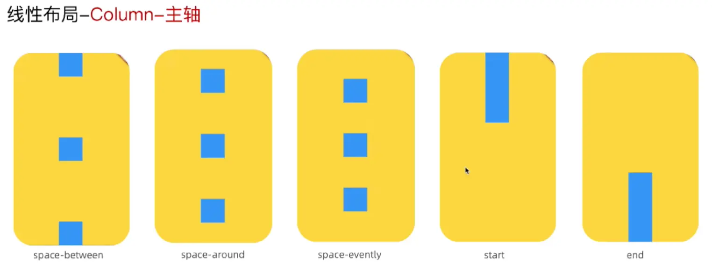
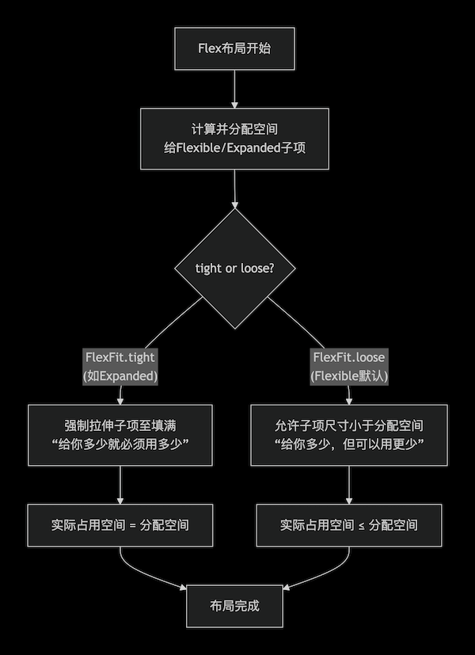

## 1.Column

`Column` 是一个多子节点的**垂直布局容器**，继承自 `Flex`，大部分布局能力来自 `Flex`，所以它布局的思想Flex（弹性）布局模型。

| 属性/参数 | 类型 | 默认值 | **作用与核心机制** | **对布局与性能的影响** |
| :--- | :--- | :--- | :--- | :--- |
| **`children`** | `List<Widget>` | `[]` (必传) | 需要垂直排列的子Widget列表。 | 布局算法的直接作用对象。列表中的每个子Widget对应一个 `FlexParentData`。 |
| **`mainAxisAlignment`** | `MainAxisAlignment` | `.start` | **主轴（垂直方向）对齐**。决定子项在垂直方向如何分布。<br>• `start`：从顶部开始排列。<br>• `end`：从底部开始排列。<br>• `center`：居中。<br>• `spaceBetween`：首尾贴边，中间等距。<br>• `spaceAround`：每个子项两侧间隔相等，首尾间隔为中间一半。<br>• `spaceEvenly`：所有间隔（包括首尾）完全相等。 | 此属性仅在主轴方向**存在剩余空间**时生效。如果 `mainAxisSize` 为 `min` 或子项总高度已占满空间，则无效果。 |
| **`crossAxisAlignment`** | `CrossAxisAlignment` | `.center` | **交叉轴（水平方向）对齐**。决定子项在水平方向如何对齐。<br>• `start`：左对齐。<br>• `end`：右对齐。<br>• `center`：水平居中（默认）。<br>• `stretch`：强制子项拉伸以填满水平最大宽度。 | 这是 `Column` 在水平方向上的核心约束来源。`stretch` 会强制传递严格水平约束。 |
| **`mainAxisSize`** | `MainAxisSize` | `.max` | **主轴尺寸策略**。<br>• `max`：尽可能高，占满父级允许的全部垂直空间（默认）。<br>• `min`：尽可能低，仅包裹子项的总高度。 | **关键区别**：`min` 会导致 `mainAxisAlignment` 失效（因无剩余空间），并可能影响父级布局。 |




**代码示例**

```dart
Column(
  mainAxisAlignment: MainAxisAlignment.spaceBetween,
  crossAxisAlignment: CrossAxisAlignment.start,
  children: [
    Text("Item 1"),
    Text("Item 2"),
    Text("Item 3"),
  ],
)
```

## 2.Row

`Row` 是一个多子节点的**水平布局容器**，继承于`Flex`，和 `Column` 基本相同，只是主轴/交叉轴方向不同。

- `mainAxisAlignment`：水平方向对齐。
- `crossAxisAlignment`：垂直方向对齐。
- `mainAxisSize`：主轴尺寸策略。


**代码示例**

```dart
// 模仿Android的标题栏
Row(
  children: [
    const SizedBox(width: 10), // 保持屏幕的安全距离
    const BackButton(),  // 返回按钮

    Expanded(
      child: Center(
        heightFactor: 1,  // 注意这个，让 Center 退出贪婪模式，变成 child高度 x 1
        child: Text(
          "标题",
          style: TextStyle(fontSize: 18, fontWeight: FontWeight.bold),
        ),
      ),
    ),

    const SizedBox(width: 48), // 保持左右对称
    const SizedBox(width: 10), // 保持屏幕的安全距离
  ],
),
```

## 3.Flex

### 3.1 基本概念

`Flex`允许子项在主轴方向（水平或垂直）上**灵活分配剩余空间**。

| 属性/参数 | 类型 | 默认值 | **作用与核心机制** | **对布局与性能的影响** |
| :--- | :--- | :--- | :--- | :--- |
| **`direction`** | `Axis` | **必传** | **布局主轴方向**。决定子 Widget 的排列方向。<br>• `Axis.horizontal`：水平排列，同 `Row`。<br>• `Axis.vertical`：垂直排列，同 `Column`。 | 这是 `Flex` 最根本的参数，决定了主轴和交叉轴。主轴是排列方向，交叉轴是其垂直方向。 |
| **`children`** | `List<Widget>` | `[]` | 要排列的子Widget列表。 | 子项可以是**非弹性**（如 `Container`）或**弹性**（被 `Flexible` 或 `Expanded` 包裹）。`Flex` 的布局算法会区别处理这两类子项。 |
| **`mainAxisAlignment`** | `MainAxisAlignment` | `.start`  | **主轴对齐**。当所有子项（包括弹性部分）在主轴上的总尺寸**小于** `Flex` 容器自身尺寸时，此属性控制如何分配剩余空间。<br>• `start`/`end`/`center`：靠起/止端、居中。<br>• `spaceBetween`：子项间等距，首尾无空隙。<br>• `spaceAround`：子项间等距，首尾为一半空隙。<br>• `spaceEvenly`：所有空隙均等。 | 仅在有**剩余空间**时生效。若 `mainAxisSize` 设为 `MainAxisSize.min` 或子项已占满空间，则无效。 |
| **`mainAxisSize`** | `MainAxisSize` | `.max`  | **主轴尺寸策略**。<br>• `max`：尽可能大，占满父级在主轴方向允许的全部空间（默认）。<br>• `min`：尽可能小，尺寸仅包裹所有子项的总和。 | **关键区别**：`min` 通常使 `mainAxisAlignment` 失效（无剩余空间）。这会影响 `Flex` 在父布局中的占用，是控制包裹行为的关键。 |
| **`crossAxisAlignment`** | `CrossAxisAlignment` | `.center`  | **交叉轴对齐**。决定子项在**交叉轴**上如何对齐。<br>• `start`/`end`/`center`：靠起/止端、居中。<br>• `stretch`：强制子项在交叉轴上拉伸，以填满可用空间。 | `stretch` 会向子项传递严格的约束（`tight`），强制其填满交叉轴。其他值则传递宽松约束。 |


> `Flex`的子组件常使用`Flexible`或`Expanded`包裹，以实现灵活的空间分配。`Flex` 先测量非 `Flexible`（包括 `Expanded`）子组件，计算剩余空间，再按 `flex` 比例分配给` Flexible`/`Expanded` 子组件。

### 3.2 Expanded和Flexible的区别

| 特性 | **`Expanded`** | **`Flexible`** |
| :--- | :--- | :--- |
| **本质** | 一个便捷的**包装类**（Wrapper）。 | 弹性布局的**基础原语**（Primitive）。 |
| **与 `Flexible` 的关系** | **完全等价于** `Flexible(fit: FlexFit.tight, flex: flex)`。 | 是 `Expanded` 的**超集**，提供更多控制。 |
| **核心控制参数 (`fit`)** | **固定为 `FlexFit.tight`**（强制填满）。 | **可配置**：`FlexFit.loose` (默认) 或 `FlexFit.tight`。 |
| **`flex` 属性** | 有，默认为1。 | 有，默认为1。 |
| **布局行为** | **强制**其子项在主轴方向**填满**分配到的所有空间。 | **取决于 `fit`**：`tight`（同Expanded）或 `loose`（允许小于分配空间）。 |
| **设计意图** | 用于需要**占据并填满**剩余空间的场景（如分割区域）。 | 用于需要**弹性但非强制**的场景（如可收缩的工具栏、自适应文本）。 |





**`Flexible`的使用场景：自适应宽度的按钮组:**
```dart
Row(
  children: [
    Flexible( // 使用 loose fit
      child: ElevatedButton(onPressed: () {}, child: Text('一个较长的按钮文本')),
    ),
    Flexible( // 使用 loose fit
      child: ElevatedButton(onPressed: () {}, child: Text('短')),
    ),
  ],
)
```

**`Flexible`的使用场景：图文混排时，防止图片过度拉伸:**
```dart
// 下面代码有个坑，可以试试，会发现 Text 不到屏幕右侧就提前换行了，是因为 Image加了 Flexible
// 在 Flutter 的 Row 中，一旦你使用了 Flexible（不论是 tight 还是 loose），布局计算就会强制进入按比例划蛋糕的阶段。
// 由于你的 Flexible 和 Expanded（Expanded 的本质就是 Flexible(fit: FlexFit.tight)）
// 都没有显式指定 flex 权重，它们的默认权重都是 flex: 1。

// 第一阶段：划定势力范围（分配 Max Width）
// Row 看到有两个 flex 组件，总宽度 402。它会非常绝对地一刀切开：
//  - 分配给 Flexible 的特权最大宽度（Max Width）：201
//  - 分配给 Expanded 的固定剩余宽度（Width）：201

// 第二阶段：组件自我约束（Loose 的真正作用）
// 这时候，FlexFit.loose 终于开始起作用了，但它的作用范围已经被死死限制在了那 201 像素内。
// 它对图片说：“在 0 到 201 像素之间，你想多宽就多宽，我不强迫你撑满 201。”
// 你的图片因为高宽比，最后只选了 75 像素
// 重点来了！ 已经分配出去的区域是无法动态回收的。Flexible 占用的这 201 像素物理空间在主轴上
// 已经对 Row 锁死了。图片自己用了 75，剩下的 126 像素（201 - 75）直接变成了空白，
// 留在了 Flexible 组件内部！
// 旁边的 Expanded 只有眼巴巴看着的份，它拿到的横向空间依然只有雷打不动的 201 像素
Row(
  children: [
    Flexible(
      fit: FlexFit.loose, // 图片保持原始宽高比，不被强制拉伸
      child: Image.asset('assets/avatar.png'),
    ),
    Flexible(
      fit: FlexFit.tight, // 文字部分填满剩余空间
      child: const Text('这是一个很长的描述文本，需要占据所有可用的剩余宽度...'),
    ),
  ],
)

// 或者代码改成 固定图片大小，不让图片参与 flex，固定尺寸组件（Non-flexible）
Row(
  mainAxisAlignment: MainAxisAlignment.start,
  children: [
    Image.asset('assets/images/dog.png', width: 75, height: 75),
    Expanded(child: Text("这是一个很长的描述文本，需要占据所有可用的剩余宽度")),
  ],
)

// 或者
Row(
  children: [
    Flexible(
      flex: 0, // 关键点
      child: Image.asset('assets/images/dog.png', width: 75, height: 75),
    ),
    Expanded(child: Text("这是一个很长的描述文本，需要占据所有可用的剩余宽度")),
  ],
)
```

理解：`Tight` vs `Loose` vs `不加 Flexible` *(假设屏幕宽度 402)*
- `Flexible(fit: FlexFit.tight)` (即 `Expanded`)：
  - “父级给我 201 宽，我必须变成 201 宽。哪怕里面的子组件只有 75 宽，我也要把自己撑大到 201。”

- `Flexible(fit: FlexFit.loose)`:
  - “父级给我 201 的最大宽上限。里面的子组件是 75 宽，那我们组件整体在屏幕上就只露出来 75 宽。**但是！右边那 126 像素的坑我已经占了，别人（文本）别想用。**”

- 不加任何 `Flexible`（刚性组件 Non-flexible）：
  - 我不需要参与切蛋糕。图片说它按比例算下来是 75 宽，那它就只切走 75 像素。剩下的 327 像素（402 - 75）全部打包送给右边的 `Expanded`。


 **Flutter Flex** | **iOS UIKit 对应概念** | **底层真实行为** 
---|---|---
 不加 Flexible <br /> (或 `Flexible(flex: 0)`) | Hugging Priority = 1000 <br /> (最高抗拉伸) | **绝对的“包裹内容”（Wrap Content）** <br /> 优先让子组件自己计算尺寸，哪怕外面是 Row，它也只切走自己刚好需要的那一丁点空间，把剩下的全部让出来。 
 `Flexible(flex:1, fit:loose)` | Hugging Priority = 250 <br /> 低抗拉伸 | **弹性上限约束** <br /> 在主轴上先强行划定一块最大势力范围（Max Width）。在这个范围内你随便长，但你用不完的空白空间，别人也休想拿去用 
 `Expanded(...)` <br /> (即 `(flex:1, fit:tight)`) | Hugging Priority = 0 <br /> 完全放弃抗拉伸 | **霸道填满** <br /> 不管里面内容有多少，强行拉伸组件的物理尺寸，直到把分给它的空间全部塞满。 

## 4.Wrap

`Wrap`**流式布局**是一个继承自 `MultiChildRenderObjectWidget` 的布局控件，对应的底层渲染对象是 `RenderWrap`（位于 `rendering/box.dart`）。

`Wrap`核心职责是：将多个子组件沿主轴（主方向）排列，当主轴空间不足时，自动换行到下一行或列。

| 属性名                    | 类型                   | 默认值                        | 说明    |
| :--------------------- | :------------------- | :------------------------- | :------------------------------------------ |
| **direction**          | `Axis`               | `.horizontal` | 主轴方向。horizontal → 水平换行（默认）；vertical → 垂直换列。 |
| **alignment**          | `WrapAlignment`      | `.start`      | 主轴方向上每一行（或列）的子组件对齐方式。   |
| **spacing**            | `double`             | `0.0`    | 主轴方向子组件之间的间距。  |
| **runAlignment**       | `WrapAlignment`      | `.start` | 交叉轴方向（换行方向）上每一“行”的整体对齐方式。  |
| **runSpacing**         | `double`             | `0.0`   | 每一行（或列）之间的间距。 |
| **crossAxisAlignment** | `WrapCrossAlignment` | `.start` | 控制交叉轴方向上子组件的对齐方式（针对单行）。 |
| **children**           | `List<Widget>`       | —  | 子组件列表。 |
| **textDirection**      | `TextDirection?`     | `null`  | 决定 `start` / `end` 的对齐方向（LTR / RTL）。(不常用) |
| **verticalDirection**  | `VerticalDirection`  | `.down`   | 控制换行的方向：从上到下（默认）或从下到上。(不常用) |
| **clipBehavior**       | `Clip`               | `.none`  | 子组件超出边界时的裁剪行为。(不常用) |


**代码示例**

```dart
class _MainPageState extends State<MainPage> {
  late final List<Color> _boxColors;  // 用来缓存生成的随机颜色，去掉“迪斯科效应”
  late final int tagCount = 10;  // tag 数量

  @override
  void initState() {  // initState 只会执行一次
    super.initState();

    final r = Random();
    _boxColors = List.generate(tagCount, (_) {
      return Color.fromARGB(
        255,
        r.nextInt(256),
        r.nextInt(256),
        r.nextInt(256),
      );
    });
  }

  @override
  Widget build(BuildContext context) {
    return Wrap(
      spacing: 10,
      runSpacing: 5,
      children: List.generate(
        tagCount,
        (index) => Container(
          height: 48,
          width: 68,
          alignment: .center,
          decoration: BoxDecoration(
            color: _boxColors[index],
            borderRadius: BorderRadius.circular(24),
          ),
          child: Text("$index", style: TextStyle(color: Colors.white)),
        ),
      ),
    );
  }
}
```

**个人标签代码示例**

```dart
import 'package:flutter/material.dart';

class UserTagsView extends StatelessWidget {
  final List<String> tags = const [
    'Flutter',
    'iOS 开发',
    'SwiftUI',
    'Objective-C 架构师',
    '音视频开发',
    'UIKit',
    '性能优化',
    'Dart 语言原理',
    'Web',
    '高刷新率适配',
  ];

  const UserTagsView({super.key});

  @override
  Widget build(BuildContext context) {
    return Padding(
      padding: const EdgeInsets.all(16.0),
      // 1. 使用 Wrap 实现流式自动换行布局
      child: Wrap(
        spacing: 8.0,    // 同一行中，标签之间的水平间距
        runSpacing: 8.0,  // 换行后，行与行之间的垂直间距
        alignment: WrapAlignment.start, // 整体对齐方式
        children: tags.map((tag) => _buildTagItem(tag)).toList(),
      ),
    );
  }

  // 构建单标签（可使用 RawChip / Chip 或自定义 Container）
  Widget _buildTagItem(String label) {
    return Container(
      padding: const EdgeInsets.symmetric(horizontal: 12, vertical: 6),
      decoration: BoxDecoration(
        color: Colors.blue.withAlpha(20),
        borderRadius: BorderRadius.circular(16),
        border: Border.all(color: Colors.blue.withAlpha(80)),
      ),
      child: Text(
        label,
        style: const TextStyle(
          fontSize: 13,
          color: Colors.blue,
          fontWeight: FontWeight.w500,
        ),
      ),
    );
  }
}
```


