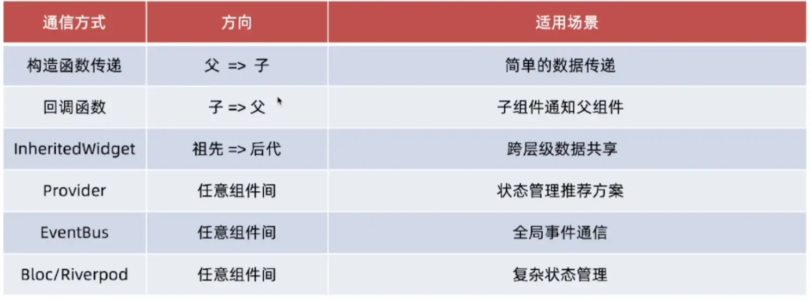

在 Flutter 中，组件通信本质上是基于 Widget 树、Element 树与 State 对象的生命周期协作。

**组件通信机制全景表**

| 通信机制 | 通信方向 | 核心原理解析 / Element 行为 | 适用场景 |
| --- | --- | --- | --- |
| **Constructor / Callback** | 父 → 子 / 子 → 父 | 通过构造函数传递不可变属性；子级触发闭包修改父级 `State` 并调用 `setState()` 标记 Element 为 `dirty`。 | 紧耦合、层级简单的单向或双向通信。 |
| **Notification** | 子 → 祖先 (逆向冒泡) | `Notification.dispatch(context)` 沿着 `Element.parent` 节点向上递归查找 `NotificationListenerElement`，类似响应者链。 | 深度嵌套的子组件向任意祖先传递事件（如滚动通知 `ScrollNotification`）。 |
| **InheritedWidget** | 祖先 → 后代 (跨级向下) | `InheritedElement` 维护 `_dependents` 哈希表。当状态更新时，直接将所有订阅依赖的 `Element` 标记为 `dirty` 并重建。 | 跨多级传递只读状态（如主题 `Theme`、语言 `Locale`、全局配置）。 |
| **ValueNotifier / Stream** | 跨树 / 解耦通信 | 基于观察者模式。通过 `ValueListenableBuilder` 将 `Element.rebuild` 范围精准局限在受影响节点，绕过父组件树构建。 | 局部高效刷新、跨组件逻辑解耦、状态响应式监听。 |
| **BuildContext 查找** | 任意 → 祖先 State | `context.findAncestorStateOfType<T>()` 以 $O(N)$ 复杂度向上遍历 Element 链表找到目标 `StatefulElement.state` 并直接操作。 | 显式触发离散的祖先行为（如 `ScaffoldMessenger.of(context)`）。 |
| **GlobalKey** | 跨层级直接控制 | 跨越 Widget 树直接持有目标 `Element` / `State` 的引用，重绘或节点迁移时保持 Element 不被销毁（Reparenting）。 | 跨树测量卡槽尺寸、受控表单重置（`FormState`）、跨节点 Element 复用。 |

---




Flutter 倡导 “**Props Down, Events Up**”，单向数据流（Unidirectional Data Flow）
  - **数据向下传递**：父组件传递不可变数据（Data）给子组件。
  - **事件向上通知**：子组件通过 Callback 通知父组件修改数据，父组件修改数据后调用自身的 `setState()` 触发重绘，将新数据再次下发


## 1.父传子

### 1.1 父传子-构造函数传参

父传子（构造函数传参数），步骤如下：
- 1.子组件定义接收属性
- 2.子组件在构造函数中接收参数
- 3.父组件传递属性给子组件
- 4.**有状态组件**在对外的类接收属性，对内的类通过 widget 对象获取对应属性
- 5.⚠️注意：子组件定义接收属性需要使用 `final` 关键字，因为属性由父组件决定，子组件不能随意更改

无状态组件示例：
```dart
class MyChildView extends StatelessWidget {
  final String message;  // 定义属性，在构造函数中接收，如果不想 required，则可以是 String?

  const MyChildView({super.key, required this.message});

  @override
  Widget build(BuildContext context) {
    return Text("我是子组件，消息是: $message", style: TextStyle(color: Colors.red));
  }
}

// 在父组件使用时，则可以传入数据：
const MyChildView(message: "小明")
```

有状态组件示例：
```dart
class MyChildView extends StatefulWidget {
  final String message; // 1.在对外的类，定义final属性，接收父组件传入的数据
  const MyChildView({super.key, required this.message});

  @override
  State<MyChildView> createState() => _MyChildViewState();
}

class _MyChildViewState extends State<MyChildView> {
  @override
  Widget build(BuildContext context) {
    // 2.在 State 类中，通过 widget 对象，获取对应的数据
    return Text("我是子组件，消息是: ${widget.message}");
  }
}
```


## 2.子传父

### 2.1 子传父-回调函数

子传父-回调函数，步骤如下：
- 1.父组件传递一个函数给子组件
- 2.子组件在合适时机调用此函数
- 3.父组件通过回调函数获得参数

代码示例：
```dart
import 'package:flutter/material.dart';

class MainPage extends StatefulWidget {
  const MainPage({super.key});

  @override
  State<MainPage> createState() => _MainPageState();
}

class _MainPageState extends State<MainPage> {
  // 状态统一在 StatefulWidget 的 State 中管理，保证生命周期稳定
  final List<String> _data = [
    'Flutter',
    'iOS 开发',
    'SwiftUI',
    'Objective-C 架构师',
    '音视频开发',
  ];

  void _handleDeleteItem(int index) {
    setState(() {
      _data.removeAt(index);
    });
  }

  @override
  Widget build(BuildContext context) {
    return MyChildView(
      dataList: List.unmodifiable(_data), // 传不可变视图，防止子组件意外修改引用
      onDeleteItem: _handleDeleteItem,
    );
  }
}

class MyChildView extends StatelessWidget {
  final List<String> dataList; // 在对外的类，定义final属性，接收父组件传入的数据
  final ValueChanged<int>? onDeleteItem; // 使用标准的 ValueChanged 类型定义回调

  const MyChildView({super.key, required this.dataList, this.onDeleteItem});

  @override
  Widget build(BuildContext context) {
    return GridView.builder(
      padding: const EdgeInsets.all(16),
      gridDelegate: const SliverGridDelegateWithFixedCrossAxisCount(
        crossAxisCount: 2,
        mainAxisSpacing: 10,
        crossAxisSpacing: 10,
      ),
      itemCount: dataList.length,
      itemBuilder: (context, index) {
        return Stack(
          children: [
            Container(
              color: Colors.blue,
              alignment: Alignment.center,
              child: Text(
                dataList[index],
                style: const TextStyle(color: Colors.white),
              ),
            ),
            Positioned(
              right: 5,
              top: 5,
              child: IconButton(
                onPressed: () => onDeleteItem?.call(index),  // 点击回调
                icon: const Icon(Icons.delete, color: Colors.red),
              ),
            ),
          ],
        );
      },
    );
  }
}
```


