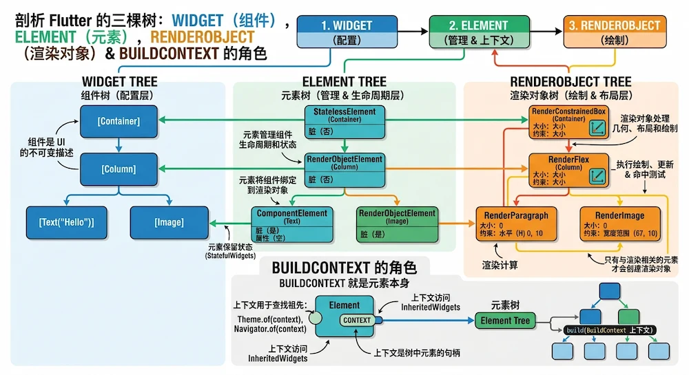

## 1.获取屏幕宽高

**获取屏幕宽高**，方案一：使用`MediaQuery.of(context)`，返回的是逻辑像素（Logical Pixels），在 iOS 平台上完全等价于 UIKit 中的“点（Points / pt），并非物理像素（Physical Pixels）。

```dart
// size.width , size.height
MediaQuery.of(context).size;
```

**获取屏幕宽高**，方案二：使用`View.of(context)`，（Flutter 3.x 推荐，直接读取 View 视口）

```dart
final view = View.of(context);

// 1. 获取物理像素 (Size)
final Size physicalSize = view.physicalSize; // 例如：Size(1179.0, 2556.0)

// 2. 获取设备像素比 (dpr)
final double dpr = view.devicePixelRatio; // 例如：3.0

// 3. 手动换算为逻辑像素
final Size logicalSize = physicalSize / dpr; // Size(393.0, 852.0)
```

----

**获取屏幕宽高**，方案三：`PlatformDispatcher.instance`，适合没有 `context` 的地方.
```dart
import 'dart:ui';

// 获取主窗口的物理尺寸
final physicalSize = PlatformDispatcher.instance.implicitView?.physicalSize;
final dpr = PlatformDispatcher.instance.implicitView?.devicePixelRatio;
```

----

工程最佳实践：编写可复用的组件时，尽量不要使用 `MediaQuery` 强行绑定屏幕全局宽高，而是使用 `LayoutBuilder` 动态获取父级传递给当前 `Widget` 的布局约束（BoxConstraints）：

```dart
Widget build(BuildContext context) {
  return LayoutBuilder(
    builder: (BuildContext context, BoxConstraints constraints) {
      // 获取当前组件可用的最大逻辑宽高
      double parentWidth = constraints.maxWidth;
      double parentHeight = constraints.maxHeight;

      return Container(
        width: parentWidth * 0.5, // 占父组件宽度的 50%
        height: 100,
      );
    },
  );
}
```

屏幕宽高总结：
  * **取屏幕宽高 + 响应键盘/SafeArea 变化** $\rightarrow$ 使用 **`MediaQuery.of(context).size`**。
  * **仅取屏幕分辨率，避免频繁 `rebuild` 性能消耗** $\rightarrow$ 使用 **`View.of(context)`**。
  * **做自适应/响应式局部组件布局** $\rightarrow$ 使用 **`LayoutBuilder`**（优先推荐）。


## 2.analysis_options.yaml

在 `analysis_options.yaml` 中开启以下规则，当你在 `async` 方法中忘记 `await` 一个 `Future` 时，编辑器（VS Code / Android Studio）会自动标黄/标红警告：

```yaml
linter:
  rules:
    - unawaited_futures # 提醒遗漏的 await
    - discarded_futures # 阻止直接忽略 Future 的返回值
```

## 3.BuildContext

`BuildContext` 是一个接口，它的底层实现类就是 **`Element`**。树上的每一个 Widget 都有属于它自己独一无二的 `BuildContext` 对象。

在 Flutter 树状架构中，Widget 树与 Element 树是一一对应的：

* 当 Widget A 被挂载到树上时，引擎会生成对应的 **Element A**。
* 当 Widget B 被挂载到树上时，引擎会生成对应的 **Element B**。

传递给 Widget A `build` 方法的 `context` 就是 **Element A**；传递给 Widget B `build` 方法的 `context` 就是 **Element B**。它们是内存中两个完全不同的对象，代表了各自在组件树中的**具体坐标位置**（类似于 iOS 中每个 `UIView` 都有自己独立的指针地址与 Frame 位置）。

```
Widget 树                      Element 树 (就是 BuildContext)
--------------------------------------------------------------
MyApp                     <--> Element_MyApp (Context 1)
  └── Scaffold            <--> Element_Scaffold (Context 2)
        └── ProfilePage   <--> Element_ProfilePage (Context 3)
              └── Text    <--> Element_Text (Context 4)

```

由于 `context` 记录了自己处于树上的哪个位置，所以当执行 `Theme.of(context)` 时，Flutter 才能以当前 `context` 的位置为起点，**沿着树向上**精准查找距离最近的 `Theme` 节点。

---

**`BuildContext` 能获得哪些对象或数据？**


通过 `context`，你可以获取当前节点自身的信息、几何物理属性以及所有祖先节点的数据：

**1. 获取当前节点与祖先节点的对象**：
* **`context.widget`**：获取当前 `context` 对应的 Widget 配置文件。
* **`context.findAncestorWidgetOfExactType<T>()`**：沿树向上查找指定类型的祖先 Widget。
* **`context.findAncestorStateOfType<T>()`**：沿树向上查找指定祖先组件的 `State` 对象（如开启 Drawer 侧边栏：`Scaffold.of(context).openDrawer()` 的底层原理）。


**2. 读取与订阅祖先 `InheritedWidget` 数据**：
* **`Theme.of(context)`**：读取全局或局部主题。
* **`MediaQuery.of(context)`**：读取屏幕宽高、安全区域 Padding、键盘高度等。
* **`Navigator.of(context)`**：获取离当前节点最近的导航路由管理器。


**3. 获取物理尺寸与渲染信息**：
* **`context.size`**：获取当前组件渲染完成后的实际 `Size`（宽/高）。
* **`context.findRenderObject()`**：获取当前节点对应的 `RenderObject`（渲染树节点，可用于计算相对于全局坐标系的绝对位置坐标）。


**4. 检查节点生命周期状态**：
* **`context.mounted`**：布尔值，用于判断当前 Element 是否仍然挂载在树上（防范异步 `setState` 崩溃）。


代码示例：
```dart
class CustomCard extends StatelessWidget {
  final String title;
  const CustomCard({super.key, required this.title});

  @override
  Widget build(BuildContext context) {
    // 0.可以获取屏幕宽高等
    final screenSize =  MediaQuery.of(context).size;

    // 1. 通过 context 获取当前节点对应的 Widget 实例
    // 比如需要把 Widget 实例本身作为参数传递给某些手势逻辑或工具库时，context.widget 就派上了用场。
    final CustomCard currentWidget = context.widget as CustomCard;
    
    // 2. 访问它的属性
    debugPrint("当前 Widget 的标题是: ${currentWidget.title}");

    return Container(
      child: Text(currentWidget.title),
    );
  }
}
```




## 4.List加if
在 Dart 的 列表字面量 (Collection `if`) 语法中，不能使用大括号 `{}`。正确写法如下：

```dart
Row(
  children: [
    if (isShow)  // Dart 的 Collection if 语法不需要大括号：
      Text('这是一个文本'),
  ],
)

// 补充技巧：需要多元素输出时使用 `...[`
Row(
  children: [
    if (isShow) ...[
      Text('这是一个文本'),
      Text('这是第二个文本'),
    ],
  ],
)
```


